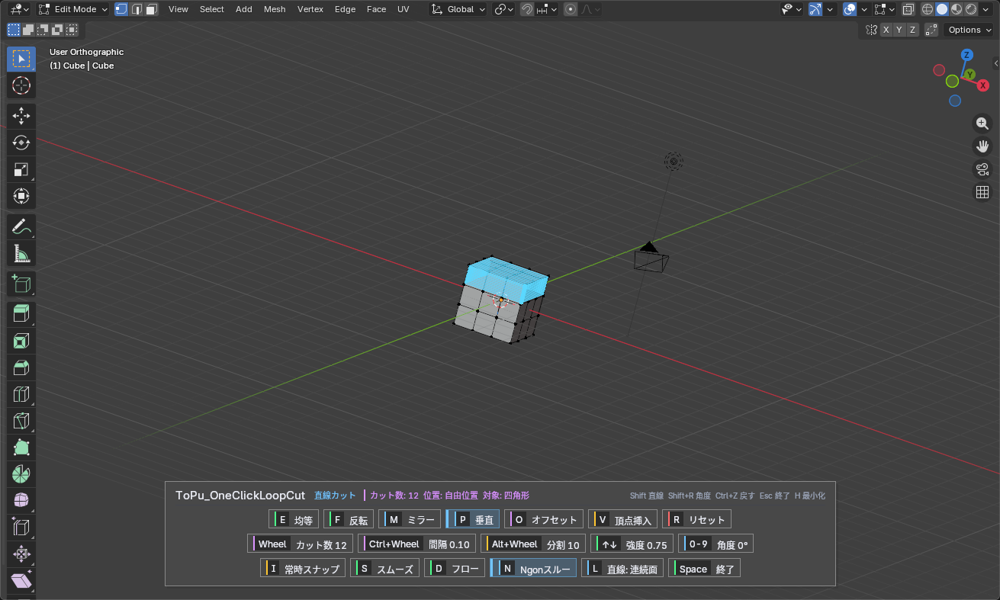

# ToPu_OneClickLoopCut

**見えている辺をクリックするだけで確定する、プレビュー一致型のループカットアドオンです。**
A loop cut that is confirmed with a single click on the visible edge, exactly along its preview.

- [日本語](#日本語)
- [English](#english)

---

## 日本語

### 主な機能

- **1クリックで確定**:カーソル下の「見えている表面の辺」を対象に、プレビュー線とまったく同じ位置でカットします。スライド操作は不要で、ツールを抜けずに続けてカットできます。
- **プレビュー一致**:プレビューで計算したカット計画をそのまま実行するため、表示と結果がずれません。高密度メッシュでも分割処理をまとめて行い、軽く動きます。
- **Ngonスルー**:頂点数の少ないNgonは割合ベースで通過します(オフにするとNgonでループが止まります)。
- **Shift直線カット**:辺に垂直な平面でまっすぐカットします。角度は数字キーや Shift+R のドラッグで指定できます。
- **カットオプション**(LoopKut風):均等 / 反転 / ミラー / 垂直 / オフセット / 頂点挿入 / 常時スナップ / フロー。
- **HUD**:実行中は画面下部にHUDを表示します。ボタンのクリック、値のドラッグ・ホイールで直接操作できます。H で最小化できます。
- 日本語 / English のUIに対応します。

### 対応環境

- Blender 4.2 以降(4.2 / 5.1 で動作確認)
- メッシュの編集モード

### インストール

1. [Releases](https://github.com/http4211/ToPu_OneClickLoopCut/releases) から ZIP をダウンロードします。
2. Blender の `編集 > プリファレンス > アドオン` で、`ディスクからインストール` を選び、ZIP を展開せずに指定します。
3. アドオン一覧で **ToPu_OneClickLoopCut** を有効にします。

**更新するとき**は、古いバージョンを無効にし、**Blender を再起動してから** 新しい ZIP を入れてください。再起動しないと、古いプログラムが読み込まれたまま残ることがあります。
以前のバージョンのプリファレンス設定(起動時のカット数・スムーズ強度など)はそのまま引き継がれます。

### 起動方法

メッシュの編集モードで、次のどれかで起動します。

| 方法 | 操作 |
| --- | --- |
| ショートカット(初期設定) | **Ctrl＋Shift＋R** |
| 右クリックメニュー | **ToPu Tools > 1クリックループカット** |
| 辺メニュー | **辺 > 1クリックループカット** |

ショートカットはアドオンプリファレンスで変更・オフにできます。
ToPu_Resample、ToPu_ViewSmooth、ToPu_CircleMaker など、ほかの ToPu アドオンと一緒に使う場合も、右クリックメニューの「ToPu Tools」は1つにまとまります。各アドオンの項目の間には区切り線が入ります。

---

### 基本操作

1. 起動したら、カットしたい辺にカーソルを合わせます。予定のカット線がプレビュー表示されます。
2. **左クリック**でカットを確定します。ツールは続けて使えます。
3. **Space / Esc / 右クリック / Enter** で終了します。

| 入力 | 動作 |
| --- | --- |
| 左クリック | 表示中の線でカット確定 |
| ホイール / ＋・− | カット数の増減 |
| Ctrl(押している間) | 50%スナップ |
| Alt(押している間) | 分割スナップ(初期値10分割＝10%刻み) |
| Alt＋ホイール | スナップの分割数を変更 |
| Shift＋ホイール | オフセット時のループ間隔を変更 |
| Shift(押している間) | 直線カット |
| Shift＋R 長押し(Alt / Ctrl 併用可) | 直線カットの角度をマウスで決める |
| 数字キー | 直線カットの角度を入力(2秒でリセット) |
| ↑ / ↓ | スムーズ強度(Blenderを閉じるまで保持) |
| S | スムーズ ON/OFF |
| N | Ngonスルー ON/OFF(設定に保存) |
| R | カットオプションをリセット |
| H | HUDの最小化・再表示 |
| Ctrl＋Z / Ctrl＋Shift＋Z | 1手戻す / やり直す |
| 中ボタン・トラックパッド・3Dマウス | 視点操作 |

### カットオプション

キーまたはHUDのボタンで切り替えます。

| キー | オプション | 内容 |
| --- | --- | --- |
| E | 均等 | カーソルに近い側の辺ループの形に沿って、一定の距離でカットします |
| F | 反転 | 均等で基準にする側を反対にします |
| M | ミラー | 辺の中心で反転した位置にもカットを追加します |
| P | 垂直 | ループのつながりを保ったまま、辺に垂直な平面上にカットを置きます |
| O | オフセット | 複数カットをカーソル中心に並べます(間隔は Shift＋ホイール) |
| V | 頂点挿入 | ループを作らず、ホバー中の辺に頂点だけを追加します |
| I | 常時スナップ | Alt を押さなくても分割スナップを使います |
| D | フロー | 新しいループを周囲の曲面に沿うように膨らませます(ループカットのみ) |
| L | 直線カット範囲 | 直線カットの範囲を「連続面のみ / メッシュ全体」で切り替えます |

均等と垂直は同時には使えません(片方をオンにするともう片方はオフになります)。
実行中に変えたオプションは Blender を閉じるまで保持されます。スムーズのON/OFFと頂点挿入は、毎回オフから始まります。

### HUD

画面下部のパネルに、ツール名・モード・状態(カット数、位置、対象)と操作ヒントを表示します。

- **1行目**:均等 / 反転 / ミラー / 垂直 / オフセット / 頂点挿入 / リセット
- **2行目**:カット数 / 間隔 / 分割 / 強度 / 角度(ドラッグまたはホイールで変更。ドラッグ中の Shift で微調整)
- **3行目**:常時スナップ / スムーズ / フロー / Ngonスルー / 直線カット範囲 / 終了

スナップ中や角度入力中は、カーソルの横に値を表示します。

### プレビューの色

| 色 | 状態 |
| --- | --- |
| 緑 | 通常のループカット |
| 黄 | Ctrl 50%スナップ |
| マゼンタ | Alt / 常時スナップ |
| 水色 | Shift 直線カット |
| オレンジ | 頂点挿入 |

### アドオンプリファレンス

| 設定 | 内容 |
| --- | --- |
| 言語 | 自動(Blenderの表示言語に合わせる)/ 日本語 / 英語 |
| ショートカット | 起動キーの変更、オン・オフ |
| 初期値 | 起動時のカット数、スムーズ強度、スナップ分割数、ループ間隔、Ngonスルー、Ngon上限頂点数 |
| 表示 | プレビュー線の太さ、HUDスケール、HUD位置、解像度に合わせる、操作ヒント、HUDを上側に表示 |

ショートカットの変更を残すには、プリファレンスを保存してください。

### 制限事項

- 対象はカーソル下の「見えている面」の辺です。隠れた面や非表示の面は対象になりません。
- Ngonスルーは、設定した上限以下の頂点数のNgonだけを通過します。複雑なNgonではループが止まることがあります。その場合は Shift 直線カットを試してください。
- フローはカット後に適用されるため、プレビュー線には反映されません。
- すべてのメッシュ・モディファイアの組み合わせで検証済みというわけではありません。

### 変更履歴

#### 1.17.0

- HUDを ToPu_Resample と同じ形式(クリック・ドラッグできるボタン式パネル)に変更しました。
- カットオプションを追加しました:均等 / 反転 / ミラー / 垂直 / オフセット / 頂点挿入 / 常時スナップ / フロー / 直線カット範囲 / リセット。
- Alt スナップの分割数を変更できるようにしました(Alt＋ホイール)。
- 右クリックメニューの「ToPu Tools」に対応しました。ほかの ToPu アドオンとまとめて表示し、区切り線を入れます。
- 日本語 / English の切り替えに対応しました。
- プリファレンスを項目ごとの枠で整理しました。
- Ctrl＋Shift＋Z(やり直し)と Enter(終了)を追加しました。
- サイドバー(Nパネル)の説明パネルを削除しました。

### ライセンスとクレジット

- **ToPu_OneClickLoopCut**:http4211 / ToPu contributors
- HUD:**ToPu_Resample** の HUD モジュールを流用・拡張
- カットオプションの構成:**Loopkut**(KEwlSheet)の機能を参考に、独自に実装
- フロー:**[EdgeFlow](https://github.com/BenjaminSauder/EdgeFlow)**(Benjamin Sauder)の Set Flow の考え方(エルミート補間)を参考に、独自に実装

ライセンスは **GPL-3.0-or-later** です。全文は [LICENSE](LICENSE) を参照してください。
参考にした作品の作者による公式版・公認版ではありません。

---

## English

### Features

- **One-click confirm**: hover a visible surface edge and click; the cut is made exactly along the preview. No slide step, and you can keep cutting without leaving the tool.
- **Preview-matched execution**: the cut plan computed for the preview is the one that is executed. Splits are batched, so dense meshes stay responsive.
- **Ngon pass-through**: light Ngons are crossed by ratio (turn it off to stop the loop at Ngons).
- **Shift straight cut**: a planar cut perpendicular to the edge; set its angle with number keys or by dragging with Shift+R.
- **Cut options** (LoopKut-style): Even / Flip / Mirror / Perpendicular / Loop Offset / Insert Verts / Always Snap / Set Flow.
- **HUD**: a clickable panel at the bottom of the view; click buttons, drag or wheel over values. Press H to minimize.
- Japanese / English UI.

### Requirements

- Blender 4.2 or later (tested on 4.2 and 5.1)
- Mesh Edit Mode

### Installation

1. Download the ZIP from [Releases](https://github.com/http4211/ToPu_OneClickLoopCut/releases).
2. In `Edit > Preferences > Add-ons`, choose `Install from Disk` and select the ZIP (do not extract it).
3. Enable **ToPu_OneClickLoopCut**.

When updating, disable the old version and **restart Blender** before installing the new ZIP. Preferences from earlier versions carry over.

### Usage

Start the tool in Mesh Edit Mode with **Ctrl+Shift+R**, **Right Click > ToPu Tools > One Click Loop Cut**, or **Edge > One Click Loop Cut**. Hover an edge, then **left-click** to cut. **Space / Esc / Right Click / Enter** finishes.

| Input | Action |
| --- | --- |
| Wheel / + − | Number of cuts |
| Ctrl (hold) | Snap to 50% |
| Alt (hold) / Alt+Wheel | Stepped snap / change the number of steps |
| Shift+Wheel | Loop spacing for Loop Offset |
| Shift (hold) | Straight cut |
| Shift+R (hold) / number keys | Pick / type the straight cut angle |
| ↑ / ↓ | Smooth strength |
| E / F / M / P / O / V | Even / Flip / Mirror / Perpendicular / Loop Offset / Insert Verts |
| I / D / L | Always Snap / Set Flow / straight cut range (connected faces or whole mesh) |
| S / N | Smooth / Ngon pass-through |
| R / H | Reset options / minimize the HUD |
| Ctrl+Z / Ctrl+Shift+Z | Undo / Redo |

Even and Perpendicular are mutually exclusive. Options changed while running are kept until Blender is closed; Smooth and Insert Verts always start off.

### Limitations

Only edges of visible faces under the cursor are targeted. Complex Ngons may stop a loop (try the Shift straight cut). Set Flow is applied after the cut and is not shown in the preview.

### License and credits

GPL-3.0-or-later. The HUD module comes from **ToPu_Resample**. The cut options follow the feature set of **Loopkut** (KEwlSheet) and Set Flow follows the idea of **[EdgeFlow](https://github.com/BenjaminSauder/EdgeFlow)** (Benjamin Sauder); both are independent implementations. Not an official or endorsed version by those authors.
